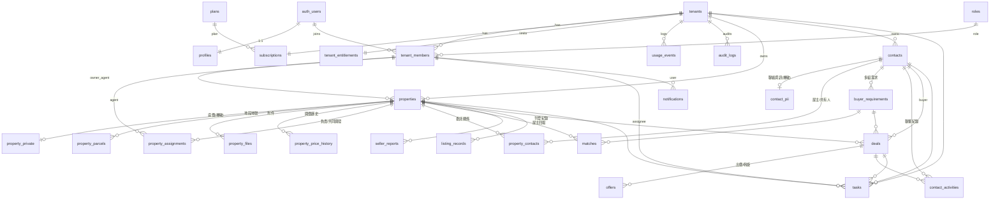

# REBECCA ESTATE AI · 系統架構

陳庭妍 AI 房仲智慧系統（專案代號 `rebecca-estate-ai`）

## 1. 現有專案分析

此 repo 原本只有「房產短影音自動剪輯系統」（`setup.sh`、`films/`、huashu-motion skill），沒有任何 Web 應用程式。
SaaS 平台以獨立子目錄 `rebecca-estate-ai/` 新建，**未修改原有影音工具**，兩者可並存。

## 2. 技術架構

```
┌────────────── 瀏覽器 / iPhone PWA ──────────────┐
│ Next.js App Router（RSC + Server Actions）      │
│  - 只持有 anon key + 使用者 session cookie        │
└───────────────────────┬─────────────────────────┘
                        │ HTTPS
┌───────────────────────▼─────────────────────────┐
│ Vercel（Next.js 伺服器）                          │
│  - Server Components / Server Actions：以使用者身分 │
│    連 Supabase，所有查詢受 RLS 約束                 │
│  - /api/cron/daily：CRON_SECRET + service_role    │
│  - OPENAI_API_KEY 只在伺服器（Phase 4）            │
└───────────────────────┬─────────────────────────┘
                        │
┌───────────────────────▼─────────────────────────┐
│ Supabase                                         │
│  Auth（Email/密碼）· PostgreSQL（RLS）· Storage（私有）│
│  pg_cron（每日延續任務，建議）                       │
└─────────────────────────────────────────────────┘
```

### 多租戶設計

- **shared database + shared schema + `tenant_id`**。
- 每張業務表都有 `tenant_id`，且所有關聯使用 **`(tenant_id, id)` 複合外鍵**，資料庫層面就不可能把 B 租戶的資料掛到 A 租戶的物件上（即使繞過 RLS 也不行）。
- `tenant_id` 變更由觸發器禁止；`created_by` 由觸發器以 `auth.uid()` 覆寫，無法冒名。
- 授權判斷集中在 `security definer` 函式：`is_tenant_member`、`has_tenant_role`、`has_tenant_permission`、`can_edit_property`、`can_view_property_private`、`can_edit_contact`、`can_view_contact_pii`、`can_edit_deal`。
- **機敏欄位以獨立資料表 + 獨立 RLS 隔離**（PostgreSQL RLS 是列層級，不是欄位層級）：
  - `property_private`：內部底價、佣金條件、屋主底線
  - `contact_pii`：電話、Email、LINE、地址
- grants 採最小權限：先收回 Supabase 預設對 `anon`/`authenticated` 的全部權限，再逐表授權；`anon` 沒有任何資料表權限。
- 方案、訂閱、額度、用量、稽核：前端**只能讀**（且用量、稽核只有經理以上可讀），寫入只能經由 `service_role` 或資料庫觸發器。

### 權限模型

| 權限 | Owner | Manager | Agent | Viewer |
|---|---|---|---|---|
| 讀取工作空間內物件/客戶基本資料 | ✓ | ✓ | ✓ | ✓ |
| 新增物件/客戶（以自己為負責人） | ✓ | ✓ | ✓ | ✗ |
| 編輯物件 | 全部 | 全部 | 自己負責或被指派共同開發 | ✗ |
| 看底價（`property_private`） | ✓ | ✓ | 自己負責/共同開發，或個別授權 | 個別授權 |
| 看客戶聯絡資訊（`contact_pii`） | ✓ | ✓ | 自己負責的客戶，或個別授權 | 個別授權 |
| restricted 檔案（謄本、合約） | ✓ | ✓ | 同底價規則 | 同底價規則 |
| 稽核紀錄、用量 | ✓ | ✓ | ✗ | ✗ |
| 調整成員權限（RPC） | ✓ | 只能調整業務/檢視者 | ✗ | ✗ |

個別授權旗標：`can_view_floor_price`、`can_view_contact_pii`、`can_export`、`can_manage_files`（`tenant_members`）。

### 資料真實性規則（資料庫強制）

- 客戶 `stage` 由低到高：研究名單 → 未聯繫 → **已聯繫** → 需求已確認 → 已推薦 → 已帶看 → 議價中 → 成交。
  沒有一筆「`status=completed` 且 `reached=true`」的聯繫紀錄，**資料庫拒絕**把客戶標為「已聯繫」以上。
- `is_public_lead`（網路查得的公司）新增時一律強制為「研究名單」。
- 接通的聯繫紀錄會自動更新 `last_contacted_at`、`next_follow_up_at`，並把未聯繫客戶推進為「已聯繫」。
- 開價異動自動寫入 `property_price_history`；重要表格異動寫入 `audit_logs`（個資只記欄位名不記內容）。
- 欄位可信度：`field_verifications` JSON（每個欄位 `status: verified | pending | expired | ai_concept`、來源、查證日期、可信度），地號與附件另有 `verification` 欄位。未知欄位維持 `NULL`，畫面一律顯示「待確認」。
- 配對 `matches.score` 是**需求匹配度**，`status` 為 confirmed/recommended 時必須有 `confirmed_by`（人工確認）。
- 屋主報告 `seller_reports` 非草稿狀態必須有 `approved_by`。
- 成交金額三分：`expected_fee`（預估，不列入業績）、`contracted_fee`（已簽約）、`received_fee`（實收）。

### Storage

- 私有 bucket `property-files`，路徑 `{tenant_id}/{property_id}/{file_id}/{檔名}`（資料庫 CHECK 強制）。
- 必須先在 `property_files` 建立中繼資料，才允許上傳到對應路徑；讀取依同一筆中繼資料的租戶與敏感度判斷。
- 下載一律以短效 signed URL（Phase 2 實作上傳/下載介面，建議 60 秒）。
- 刪除限經理以上。

### 排程

- `public.carry_over_tasks()`：未完成任務（todo / in_progress / blocked）且排定日早於今天（台北）→ 移到下一工作日，`carried_over_count + 1`，`original_date` 保留。可重複執行（冪等）。
- `v_tasks.is_stale`：`今天 − original_date > 2` 個日曆日仍未完成。
- 執行方式（擇一）：Supabase `pg_cron`（建議）或 Vercel Cron 呼叫 `/api/cron/daily`。

## 3. 資料庫 ERD



### 資料表一覽

| 資料表 | 說明 | 軟刪除/封存 |
|---|---|---|
| `tenants` | 租戶（公司/團隊/個人） | `deleted_at` |
| `profiles` | 使用者顯示資料 | — |
| `roles` | 角色參考表 | — |
| `tenant_members` | 成員、角色、獨立敏感權限 | `status` |
| `plans` | 方案（trial / solo / pro / team） | `is_active` |
| `subscriptions` | 訂閱（mock 金流，預留 newebpay/ecpay/tappay） | — |
| `tenant_entitlements` | 由方案同步的額度 | — |
| `usage_events` | AI 次數、Token、成本、匯出 | — |
| `audit_logs` | 稽核（不可改不可刪） | — |
| `properties` | 房源主檔 + `field_verifications` | `archived_at` / `deleted_at` |
| `property_private` | 內部底價、佣金條件 | 隨主檔 |
| `property_parcels` | 地段地號、持分、查證狀態 | — |
| `property_files` | 附件中繼資料、敏感度、核實與到期 | `deleted_at` |
| `property_price_history` | 開價歷史（觸發器寫入） | — |
| `property_assignments` | 負責/共同開發/助理、分配比例 | — |
| `contacts` | 客戶主檔、分級、階段、行銷授權、勿擾 | `archived_at` / `deleted_at` |
| `contact_pii` | 電話、Email、LINE、地址 | 隨主檔 |
| `property_contacts` | 物件與屋主多對多 | — |
| `buyer_requirements` | 買方需求（多組）、排除條件 | `deleted_at` |
| `contact_activities` | 電話/LINE/Email/面談/帶看/議價紀錄 | `deleted_at` |
| `matches` | 配對分數與原因 | `status=dismissed` |
| `seller_reports` | 屋主週報（草稿→核准→寄送） | — |
| `listing_records` | 各平台刊登網址與狀態 | `status=removed` |
| `deals` | 成交管線 | `deleted_at` |
| `offers` | 出價、斡旋、要約 | — |
| `tasks` / `v_tasks` | 待辦、延續、逾期標記 | `deleted_at` |
| `notifications` | 站內通知 | `read_at` |

後續階段將新增：`developer_profiles`、`developer_land_records`（Phase 3）、`marketing_contents`、`brand_settings`（Phase 4）、`deal_stage_history`、`import_jobs`（Phase 5）。

## 4. 頁面清單

「需 Supabase 驗證」＝程式與資料庫規則已完成並通過測試，但登入後的畫面尚未在真實 Supabase 上端對端跑過。

| 路徑 | 說明 | 狀態 |
|---|---|---|
| `/` | 依登入狀態導向 | ✓ |
| `/setup` | 未設定 Supabase 時的設定說明 | ✓ |
| `/login`、`/signup` | 登入、註冊（支援邀請回跳） | ✓（需 Supabase 驗證） |
| `/auth/callback`、`/auth/signout` | Email 驗證回跳、登出（僅 POST） | ✓（需 Supabase 驗證） |
| `/onboarding` | 建立工作空間 | ✓（需 Supabase 驗證） |
| `/invite/[token]` | 接受成員邀請 | Phase 2 ✓（需 Supabase 驗證） |
| `/w/[slug]/dashboard` | Dashboard、快速新增（待辦／電話紀錄／物件／買方） | ✓（需 Supabase 驗證） |
| `/w/[slug]/properties` | 房源列表、搜尋、篩選、封存檢視 | Phase 2 ✓（需 Supabase 驗證） |
| `/w/[slug]/properties/new`、`/[id]/edit` | 新增（含重複提醒、底價）、編輯 | Phase 2 ✓（需 Supabase 驗證） |
| `/w/[slug]/properties/[id]` | 明細：查證狀態、底價、地號、附件上傳/短效下載、屋主、共同開發、開價歷史 | Phase 2 ✓（需 Supabase 驗證） |
| `/w/[slug]/contacts`、`/new`、`/[id]`、`/[id]/edit` | 客戶 CRM、個資遮罩、聯繫紀錄、重複提醒 | Phase 2 ✓（需 Supabase 驗證） |
| `/w/[slug]/contacts/[id]/requirements/new`、`/w/[slug]/requirements`、`/requirements/[id]/edit` | 買方需求 | Phase 2 ✓（需 Supabase 驗證） |
| `/w/[slug]/activities/new` | 手機快速記錄聯繫（可同時建立追蹤待辦） | Phase 2 ✓（需 Supabase 驗證） |
| `/w/[slug]/tasks` | 今日／今日回顧／本週結算／全部未完成；團隊檢視（經理） | Phase 2 ✓（需 Supabase 驗證） |
| `/w/[slug]/notifications` | 站內通知 | Phase 2 ✓（需 Supabase 驗證） |
| `/w/[slug]/settings` | 成員權限調整、邀請連結、個人提醒時段、方案額度 | Phase 2 ✓（需 Supabase 驗證） |
| `/w/[slug]/matches`、`/developers` | 配案、建商 | Phase 3 |
| `/w/[slug]/marketing` | AI 行銷中心 | Phase 4 |
| `/w/[slug]/deals`、`/reports` | 成交、報表 | Phase 5 |
| `/api/cron/daily` | 備援排程（`?job=carry_over` / `reminders`） | ✓ |

## 5. 開發階段

| 階段 | 內容 | 狀態 |
|---|---|---|
| Phase 1 | 專案初始化、ERD、核心資料表與 RLS、Storage 權限、Auth、多工作空間、Dashboard、設定頁、PWA、安全測試 | 完成 |
| Phase 2 | 物件（地號、附件、查證、底價、開價歷史、重複提醒、搜尋封存）、客戶（個資遮罩、重複提醒）、買方需求、聯繫紀錄、任務頁、成員邀請與權限調整、提醒排程與站內通知 | 完成（待真實 Supabase 驗證） |
| Phase 3 | 建商資料庫、公開線索／實際需求分離、規則式配對引擎（0–100、原因、排除、未知）、變更時重算、人工確認 | 未開始 |
| Phase 4 | AI 行銷（OpenAI，只用已核實欄位）、平台模板、品牌設定、審核流程、版本與成本、PDF/DM、刊登紀錄、屋主週報 | 未開始 |
| Phase 5 | 成交管線、出價紀錄、成交漏斗、CSV 匯入匯出、備份與刪除流程、金流抽象、整合測試、部署 | 未開始 |

### Phase 2 新增的資料庫物件（`20261101000500_phase2.sql`、`20261101000600_schedules.sql`）

- `tenant_invitations`：邀請只存 token 雜湊；`invite_member`／`accept_invitation`／`revoke_invitation`（Email 必須相符、7 天到期、一次性、席次上限）
- `member_preferences`：每人提醒時段；`generate_reminders()`：上午 TOP 3、晚上回顧、週結算、委託 7/3/1 天前到期提醒（以 dedupe_key 去重）
- `find_duplicate_properties`（地址正規化、名稱、地號）、`find_duplicate_contacts`（電話含 +886、Email 大小寫；不回傳個資）
- `create_contact`：客戶與聯絡資訊同一交易建立
- `contact_pii.phone_normalized`／`email_normalized` 衍生欄位（稽核時忽略）
- pg_cron 排程：每天 00:05 延續待辦、每小時產生提醒

## 6. 檔案結構（Phase 1 建立）

```
rebecca-estate-ai/
├── supabase/
│   ├── migrations/
│   │   ├── 20261031000100_tenancy.sql      租戶、成員、方案、訂閱、額度、稽核、RPC
│   │   ├── 20261031000200_business.sql     業務資料表、觸發器、v_tasks、carry_over_tasks
│   │   ├── 20261031000300_rls_grants.sql   RLS 與最小權限 grants
│   │   └── 20261031000400_storage.sql      私有 bucket 與 Storage RLS
│   └── tests/supabase_shim.sql             測試用 Supabase 模擬層（不可套用到正式環境）
├── src/
│   ├── middleware.ts                        session 刷新、受保護路由
│   ├── lib/
│   │   ├── env.ts · utils.ts · format.ts · tasks.ts · validation.ts · modules.ts
│   │   ├── workspace.ts                     依網址載入工作空間（RLS 驗證成員資格）
│   │   ├── dashboard.ts                     Dashboard 真實查詢
│   │   └── supabase/{server,middleware,admin}.ts
│   ├── components/{ui,shell}/ · brand.tsx · forms.tsx · sw-register.tsx
│   └── app/
│       ├── (auth)/{login,signup}/ · auth/{callback,signout}/ · setup/ · onboarding/
│       ├── w/[slug]/{layout,dashboard,settings,[module]}/
│       ├── api/cron/daily/route.ts
│       └── manifest.ts · layout.tsx · not-found.tsx
├── public/{sw.js,offline.html,icons/}
├── tests/{unit,db,e2e}/
└── vitest.config.ts · playwright.config.ts · vercel.json · .env.example
```
